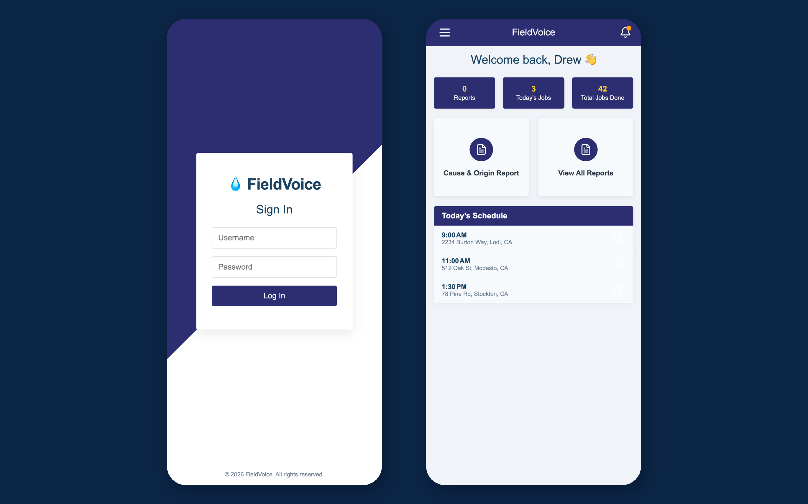

<div align="center">

# 💧 FieldVoice

**An AI voice assistant that writes inspection reports for field crews.**

Inspectors talk through a job on their phone. FieldVoice asks each question out loud, listens to the answer, rewrites it into professional report language with OpenAI, and produces a structured, ready-to-send report. No typing.

     



</div>

---

## The problem

Water-damage inspectors spend their day on site, often with wet hands, gloves on, or climbing around a crawlspace. Typing up a detailed "cause and origin" report on a phone afterward is slow, and details get lost.

## The solution

FieldVoice turns the report into a conversation:

1. The inspector picks a job from **today's schedule** and starts a report.
2. The app **asks each question out loud** (AWS Polly text-to-speech) and **listens** for the answer (Web Speech API).
3. Free-form answers are **refined by OpenAI** into clear, professional wording, while short answers like addresses are **normalized** with simple rules.
4. The finished report is **formatted from a template** and saved, ready to review.

## Highlights

- **Template-driven report engine.** Every report is defined in JSON: the questions, field types, sections, AI refinement prompts and output layout. Adding a new report type means writing a new template, not new code. See [`frontend/src/templates`](frontend/src/templates) and [`frontend/src/engine`](frontend/src/engine).
- **Voice wizard.** `runWizard` drives the whole flow step by step: speaking prompts, listening with per-step timeouts, confirming dates ("I have the date as today, is that correct?"), and filling the form as it goes.
- **Per-step AI refinement.** Each step can declare its own system prompt and output format, so the model rewrites messy speech into consistent, professional report language.
- **Mobile-first UI.** Built for one-handed phone use in the field, with large tap targets, smooth transitions (Framer Motion), and a viewport fix for mobile browser toolbars.
- **Two deployment modes.** A standalone Express API for local development, and the same endpoints as **Vercel serverless functions** for production.

## Tech stack

| Layer | Tools |
| --- | --- |
| Front end | React 19, Vite, React Router, React Hook Form, Styled Components, Framer Motion |
| Voice | OpenAI Realtime API (gpt-realtime-2.1 speech-to-speech over WebRTC); basic fallback: Web Speech API + AWS Polly |
| AI | OpenAI Chat Completions |
| Back end | Node.js, Express (controllers, routes, services, error middleware) |
| Deploy | Vercel static build plus serverless `/api` functions |

## Architecture

```
fieldvoice/
├── frontend/                 # React + Vite single-page app
│   ├── api/                  # Vercel serverless functions: /api/chat, /api/tts, /api/health
│   └── src/
│       ├── engine/           # runWizard, applyRefine, applyNormalize, formatOutput
│       ├── templates/        # JSON report definitions
│       ├── components/       # voice (stt/tts), reports, schedule, nav
│       └── pages/            # Landing, Home, ViewReports
└── backend/                  # Express API for local development
    ├── routes/ → controllers/ → services/
    └── middleware/errorHandler.js
```

```
Inspector speaks ─▶ Web Speech API ─▶ runWizard ─▶ applyRefine (OpenAI) / applyNormalize
                                          │
        AWS Polly ◀── next question ◀─────┘ ─▶ formatOutput ─▶ saved report
```

## Running it locally

**Requirements:** Node.js 20+ and an OpenAI API key with credits. AWS Polly credentials are optional (only used by the basic fallback voice).

```bash
# 1. Back end (port 3000)
cd backend
npm install
npm run dev

# 2. Front end (port 5173), in a second terminal
cd frontend
npm install
npm run dev
```

Then open http://localhost:5173 and allow microphone access. The sign-in screen is a demo login, so any username and password works.

### Environment variables

`backend/.env`

```dotenv
OPENAI_API_KEY=your-openai-key
OPENAI_MODEL=gpt-5.6-terra
# Optional: realtime voice model and voice
# REALTIME_MODEL=gpt-realtime-2.1        (or gpt-realtime-2.1-mini to save money)
# REALTIME_VOICE=marin                   (or cedar)
# Optional: AWS Polly, only for the basic fallback voice
AWS_REGION=us-east-1
AWS_ACCESS_KEY_ID=your-aws-key
AWS_SECRET_ACCESS_KEY=your-aws-secret
TTS_VOICE=Joanna
TTS_ENGINE=generative
PORT=3000
```

`frontend/.env`

```dotenv
VITE_API_BASE_URL=http://localhost:3000/api
```

When deploying to Vercel, set the same OpenAI and AWS variables in the project settings so the serverless functions can use them. `.env` files are git-ignored.

## Roadmap

- [ ] Photo capture for damage, moisture and thermal images (already defined in the report template)
- [ ] Inspector signature pad for sign-off
- [ ] Export to PDF and send to Slack or email
- [ ] Real authentication and a hosted database in place of browser storage
- [ ] Offline mode for jobs with no signal

## Author

Built by **Drew Gomez**, full stack engineer. [drew-gomez.com](https://drew-gomez.com) · [GitHub](https://github.com/andrewgomez1992) · [LinkedIn](https://www.linkedin.com/in/andrewgomez1992)
